# szukaj_cpu

A small, self-hosted NVR for home servers without a dedicated GPU. It records your IP
cameras around the clock, finds people and cars with a YOLO model running on the CPU
(OpenVINO), and shows everything in one web panel: live view, recordings on a timeline,
an event gallery and a full configurator. Cameras and motion sensors also appear in the
Apple Home app (HomeKit), with notifications that include a snapshot.

The project was **inspired by [Shinobi](https://shinobi.video)**. It started as an AI
detector that marked events on the Shinobi timeline, and grew into a replacement for
Shinobi (recording, live view, playback) and for the HomeKit bridge of Home Assistant.
It keeps Shinobi's recording layout and file names, so existing Shinobi recordings show up
on the timeline and are cleaned up by the same retention rules.

Developed and used on Debian 13 (OpenMediaVault 8) with an Intel Core i5-7500 (HD 630) and
two cameras (Dahua, Tiandy). The web panel and logs are in Polish.

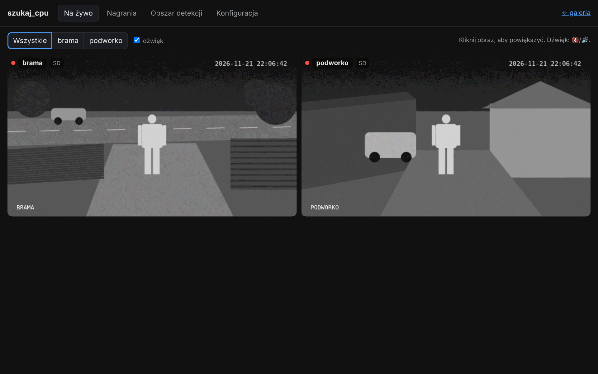

## Features

**Detection**
- YOLO11 or YOLO26 (Ultralytics), exported to OpenVINO in **FP32 or INT8**; runs on the CPU,
  about 110–190 ms per frame on an i5-7500. Video is decoded on the Intel iGPU (VAAPI).
- Detection on the camera substream (keyframes only), recording from the main stream.
- Per camera: a **zone** (polygon where a person must stand) and a **crop** (part of the frame
  sent to the model), drawn on a live snapshot in the browser.
- **Parked-vehicle filter**: a car standing in one place stops raising new events.

**Events**
- Gallery with thumbnails, full-resolution frames (JPEG XL / JPEG / WebP) and short clips cut
  from the main stream.
- Push notifications through [ntfy](https://ntfy.sh) with a photo, a link to the recording and
  buttons Recording / Gallery.
- HomeKit motion sensors per class (e.g. person, car) with snapshot notifications in Apple Home.
- Optional event markers on the Shinobi timeline.

**Recording and playback** (Shinobi replacement)
- 24/7 recording without re-encoding, in 15-minute files aligned to the clock, with audio (AAC).
  Shinobi's directory layout and file names; crash-safe (fragmented MP4 while writing).
- Retention by age and by free disk space.
- **Recordings page**: a day timeline per camera with detected events, click to play,
  1×–16× speed, jump between events, download.

**Live view**
- All cameras in the browser through go2rtc (MSE), about 1 s latency, SD/HD, sound, full
  screen. The picture is not transcoded; one connection per camera stream is shared by
  detection, recording, live view and HomeKit.

**Apple Home (HomeKit)**
- Each camera is a HomeKit accessory (pairing code and QR in the panel). The H.264 main
  stream goes to the iPhone / Apple TV as is; camera audio is converted to Opus.

**Web panel**
- Configurator for every option of `szukaj_cpu.toml` (comments and layout preserved, passwords
  never sent to the browser), RTSP address wizard and stream test, model switching and upload.
- HTTP Basic login with a lockout after repeated wrong passwords; listen address can be
  limited to `127.0.0.1` for Tailscale Serve.

## Architecture

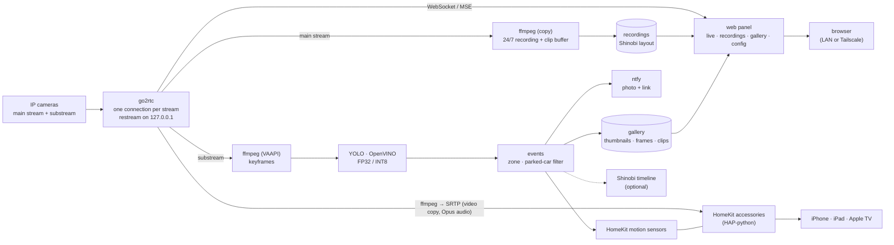

One Python service (`szukaj_cpu@<user>`, systemd) supervises everything:

| Part | Role |
|---|---|
| `go2rtc` (bundled) | Connects once to each camera stream and restreams it locally; serves the live view (MSE over WebSocket, passed through the panel). |
| Detection | ffmpeg decodes substream keyframes on the iGPU; YOLO runs in OpenVINO directly (no PyTorch at runtime). |
| Recorder | The same ffmpeg process writes 24/7 recordings and a RAM buffer for clips; files are finalised and cleaned up in the background. |
| Events | Zone and parked-vehicle filter, gallery entry, best full-resolution frame, clip, ntfy, HomeKit sensors, Shinobi. |
| HomeKit | One HAP-python accessory per camera; ffmpeg copies H.264 to SRTP, audio is re-timed for Apple and encrypted by the service. |
| Web panel | Python HTTP server: gallery, live view, recordings with HTTP Range, detection-area editor, configurator. |

Source layout:

```
src/run.py              launcher
src/szukaj_cpu/
  main.py               start-up, main loop          config.py     reading/validating the TOML
  camera.py             ffmpeg readers, buffer       detector.py   YOLO in OpenVINO, zone/crop
  events.py             events, parked-car filter    gallery.py    HTML gallery, CSV, retention
  clips.py              clips, full-resolution frames notify.py    ntfy, Shinobi
  recorder.py           24/7 recording, retention    go2rtc.py     go2rtc process and config
  homekit.py            HomeKit accessories          export.py     YOLO → OpenVINO (FP32/INT8)
  web/                  web server and pages (live, recordings, detection area, configurator)
tools/                  ffmpeg build, model export and comparison
packaging/              .deb build (Debian 13 container)
```

## Requirements

- Debian 13 (or OpenMediaVault 8) on x86-64; an Intel CPU with iGPU is recommended (VAAPI).
- IP cameras with RTSP: a main stream in **H.264** (HomeKit needs H.264) and a substream
  for detection (set its keyframe interval to 1 s).
- For HomeKit: the server in the same LAN as the Apple devices.

## Installation

Download `szukaj-cpu_<version>_amd64.deb` from [Releases](../../releases). The package
contains everything (Python wheels, models, static ffmpeg, go2rtc) and installs offline.

```bash
sudo apt install ./szukaj-cpu_<version>_amd64.deb
szukaj-cpu --init                       # creates ~/.szukaj_cpu/szukaj_cpu.toml
sudo usermod -aG render,video $USER     # iGPU access (log in again)
nano ~/.szukaj_cpu/szukaj_cpu.toml      # at least: cameras, paths, and in [gallery]
                                        # http_port = 8091, http_user, http_password
szukaj-cpu --test                       # checks cameras and the model
sudo systemctl enable --now szukaj_cpu@$USER
```

Then open `http://SERVER:8091/admin/config` and set the rest in the browser.
Logs: `journalctl -u szukaj_cpu@$USER -f`.

## Configuration

Every option is described in [`config/szukaj_cpu.toml`](config/szukaj_cpu.toml) and can be
edited in the panel (**Konfiguracja**). The main sections:

| Section | What it sets |
|---|---|
| `[[camera]]` | name, main and analysis RTSP URLs, zone, crop, recording, HomeKit and its sensors |
| `[detection]` | classes, confidence, threads, frame selection, FP32/INT8 |
| `[recording]` | 24/7 recording, file length, retention, minimum free space, audio |
| `[go2rtc]` | restream and live view |
| `[homekit]` | HomeKit accessories, ports, sensor hold time |
| `[gallery]` | gallery retention, panel port, login, listen address, login lockout |
| `[notifications]` | ntfy topic and token, panel address for links in notifications |
| `[paths]` | recordings root, gallery, model, ffmpeg |

### Remote access

Do not forward the panel port to the internet. Use [Tailscale](https://tailscale.com): set
`http_listen = "127.0.0.1"` and publish the panel in your tailnet with HTTPS:

```bash
sudo tailscale serve --bg --https=8443 http://127.0.0.1:8091
# → https://<server>.<tailnet>.ts.net:8443
```

Notifications: the public ntfy.sh deletes photos after 3 hours. `ntfy/setup-ntfy.sh` (also in
`/opt/szukaj_cpu/ntfy/`) installs a local ntfy server that keeps them as long as the gallery.
If a self-hosted ntfy already uses the main address (`https://<server>.<tailnet>.ts.net`),
keep it there and give the panel its own port as above.

## Building from source

The package is built in a Debian 13 container (Docker or Podman); the first build compiles
ffmpeg (with libjxl and libopus) and exports the models, later builds reuse the cache in `build/`.

```bash
./build-local.sh          # → dist/szukaj-cpu_<version>_amd64.deb
```

`packaging/build-deb.sh --help` lists the options (INT8 calibration on your own frames,
model sizes, slim package).

## Screenshots

The screenshots use synthetic test video.

| | |
|---|---|
| <br>**Live view** – all cameras, SD/HD, sound, full screen | 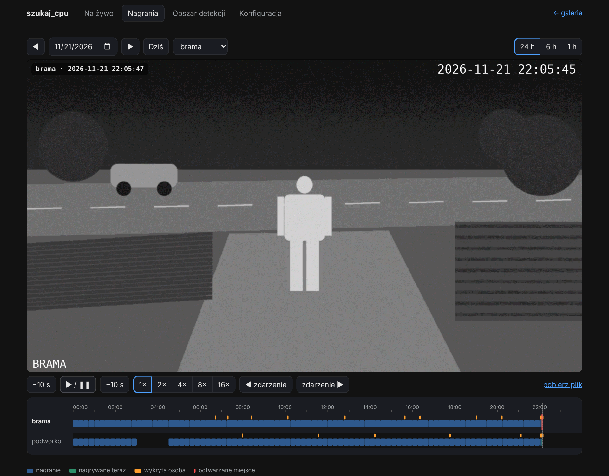<br>**Recordings** – day timeline with detected events |
| 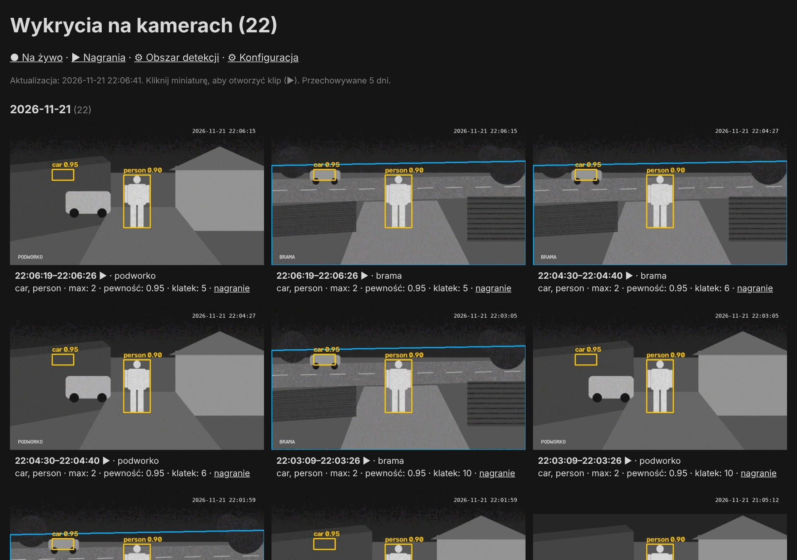<br>**Gallery** – events with thumbnails, frames and clips | 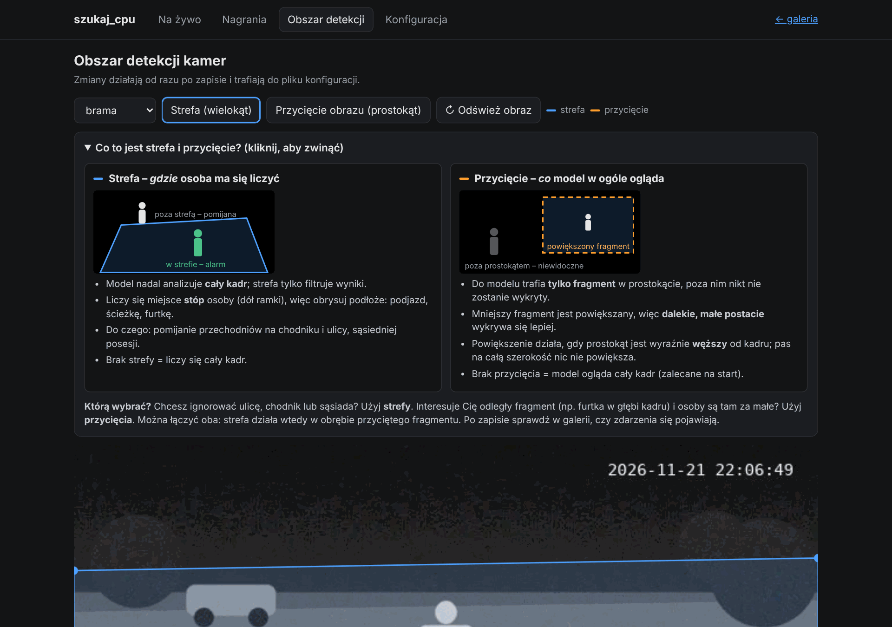<br>**Detection area** – zone and crop drawn on a snapshot |
| 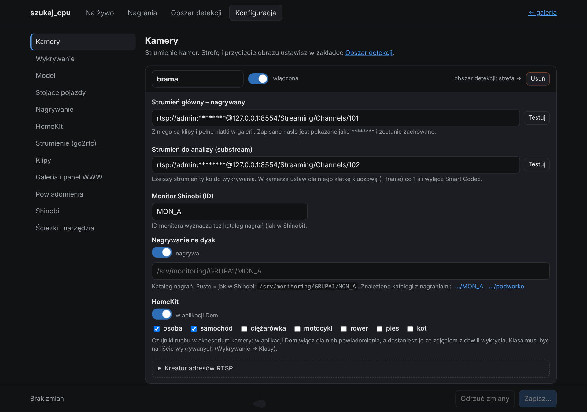<br>**Configuration · Cameras** – RTSP wizard, stream test, recording, HomeKit | 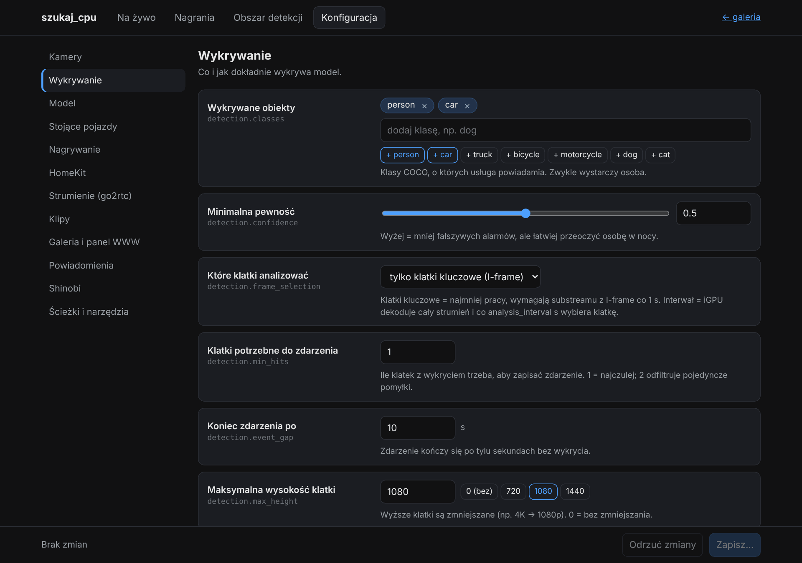<br>**Configuration · Detection** |
| 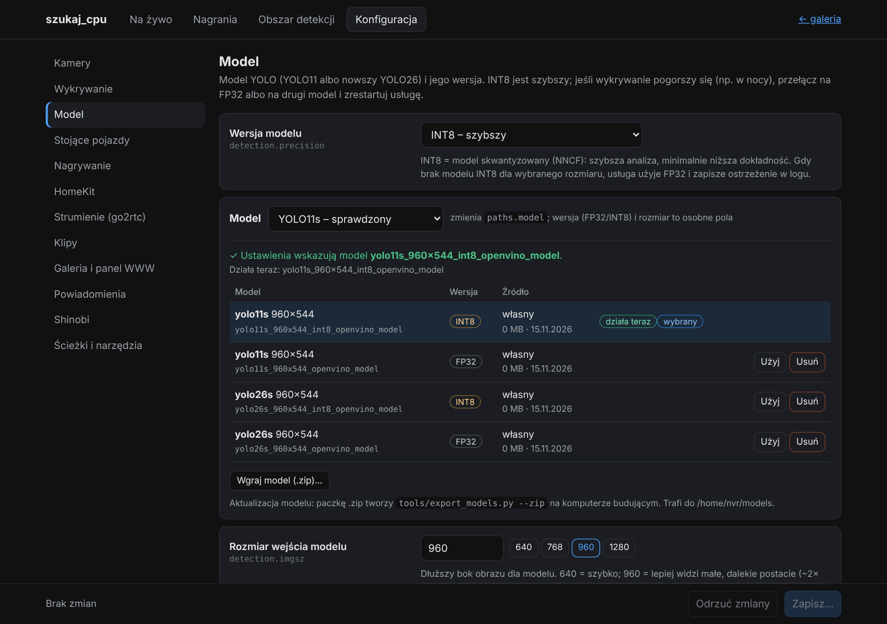<br>**Configuration · Model** – YOLO11/YOLO26, FP32/INT8, upload | 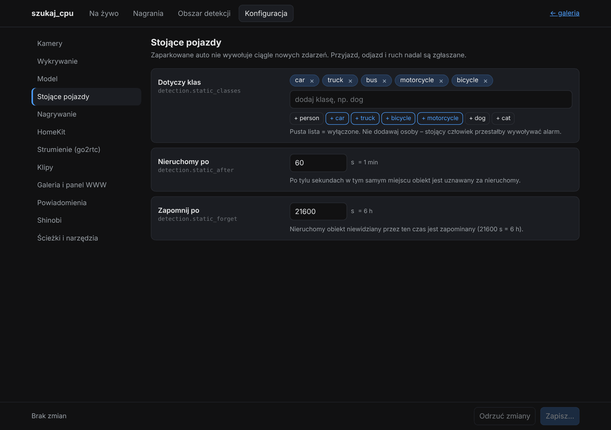<br>**Configuration · Parked vehicles** |
| 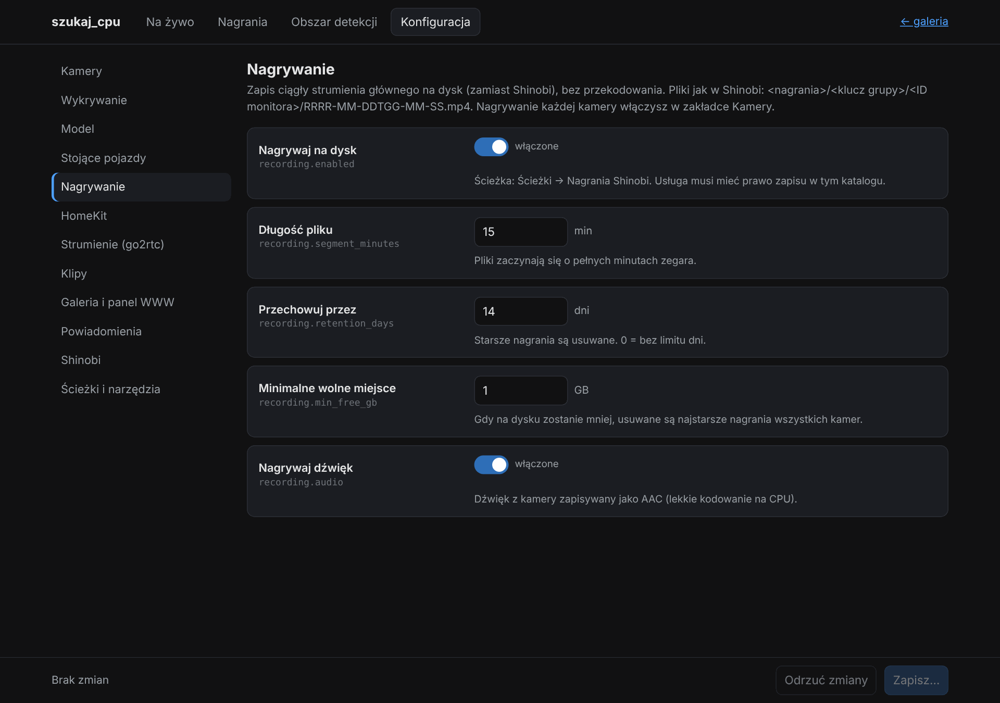<br>**Configuration · Recording** | 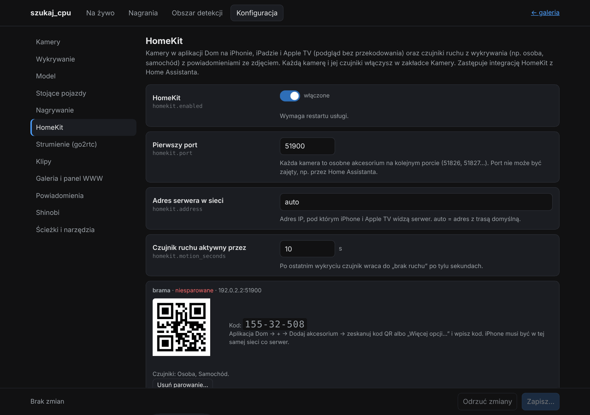<br>**Configuration · HomeKit** – pairing code and QR |
| 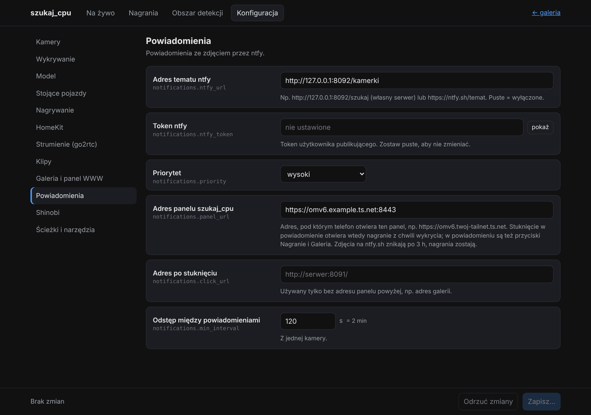<br>**Configuration · Notifications** | 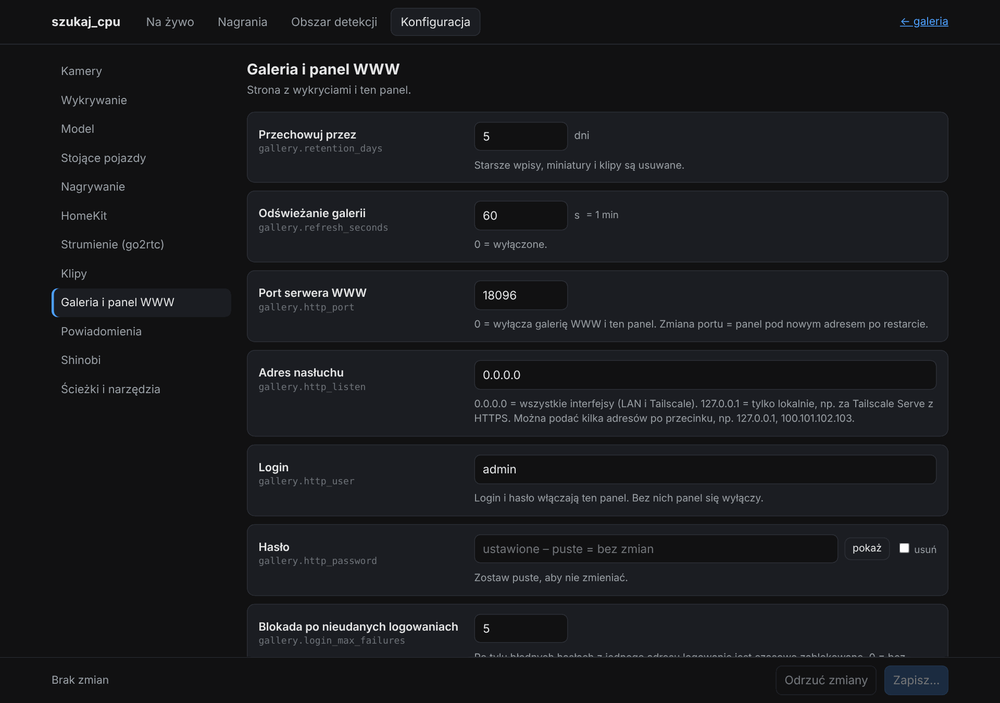<br>**Configuration · Gallery and web panel** – login, listen address, lockout |
| 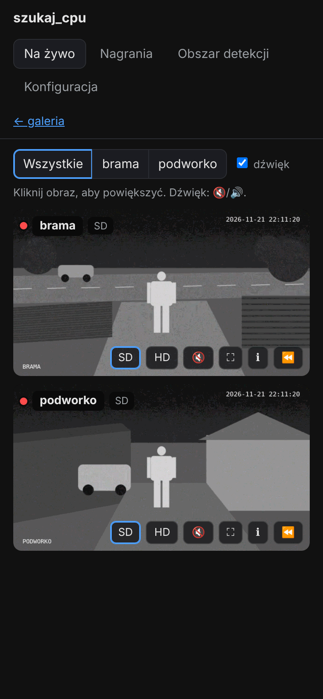<br>**Phone · Live view** | 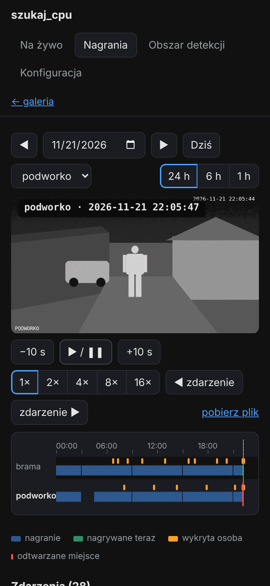<br>**Phone · Recordings** |

## Notes

- YOLO11/YOLO26 weights come from Ultralytics (AGPL-3.0). They are not part of this
  repository; the package contains models exported from them.
- Bundled third-party software: [go2rtc](https://github.com/AlexxIT/go2rtc) (MIT),
  [FFmpeg](https://ffmpeg.org) (LGPL/GPL), [OpenVINO](https://github.com/openvinotoolkit/openvino)
  (Apache-2.0), [HAP-python](https://github.com/ikalchev/HAP-python) (Apache-2.0).
